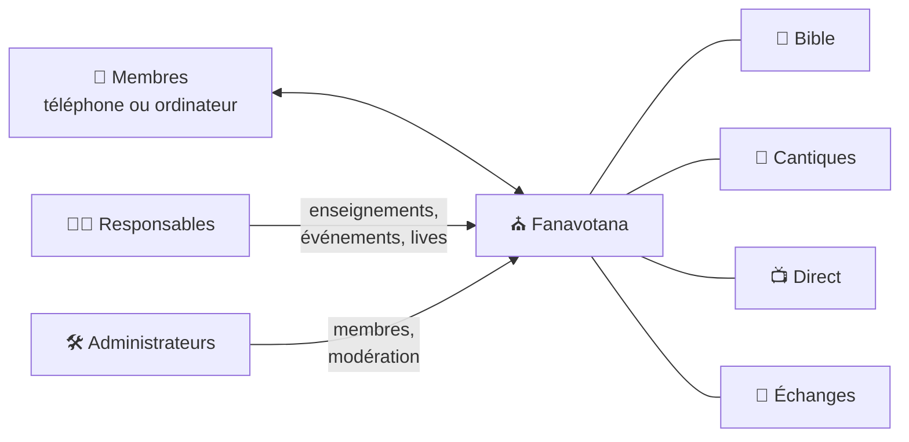

# Fanavotana — L'application de toute une église, en malgache

**En bref :** une plateforme web pour l'église FIKJ. Les membres y lisent la Bible en
malgache, chantent avec les recueils de cantiques, suivent les cultes en direct et
échangent entre eux, au même endroit.

🔗 **En ligne :** [fanavotana-fikj.com](https://fanavotana-fikj.com/)

[English version below](#english-version)

---

## Le besoin

La vie d'une église passe par de nombreux supports : Bible papier, recueils de cantiques,
groupes de discussion sur les réseaux sociaux, annonces orales, vidéos dispersées.
Les membres éloignés ou empêchés perdent vite le fil.

Fanavotana réunit tout cela dans une seule application, en malgache, accessible depuis
un téléphone ou un ordinateur.

## Ce que l'application permet

### 📖 Baiboly : lire et étudier la Bible

- Choisir un livre, un chapitre et des versets en trois touches.
- **Surligner** un verset (5 couleurs) et y ajouter **une note personnelle**.
- Garder ses versets favoris et retrouver l'historique de lecture.
- Suivre un **plan de lecture** : une barre montre la progression sur les 1 189 chapitres de la Bible.
- Rechercher un mot dans toute la Bible.

### 🎵 Fihirana : les recueils de cantiques

- **Trois recueils** consultables, avec recherche par numéro ou par titre.
- **Changement de tonalité** en un clic, pour adapter un chant à la voix ou à l'instrument.
- Cantiques favoris et historique des 50 derniers chants consultés.

### 🎙️ Fampianarana : les enseignements

- Les responsables rédigent et publient les enseignements.
- Lecture en plein écran au format page A4, et **export PDF** pour l'impression.
- Les enseignements publiés sont aussi lisibles sans compte.

### 📺 Cultes et événements en direct

- Diffusion en direct depuis l'application, avec le nombre de spectateurs.
- **Rediffusions** pour ceux qui n'ont pas pu suivre.
- Annonce des événements, avec inscriptions.

### 💬 La vie de la communauté

- Un fil d'actualité où l'on partage textes, vidéos, liens et documents.
- Réactions adaptées : ❤️ j'aime, 🙏 je prie, ✝️ amen.
- Messages privés et conversations de groupe, **en temps réel**.
- Albums photos et bibliothèque de médias.

### 🔐 Chacun son rôle

Trois niveaux d'accès : **membre**, **responsable** et **administrateur**. Un espace
d'administration permet de gérer les membres, de modérer les publications et d'organiser
les lives. L'accès à certains recueils peut être demandé puis accordé par un administrateur.

## Vue d'ensemble

## Mon rôle

J'ai conçu et développé l'application de bout en bout :

- définition des besoins avec l'église ;
- conception des écrans, pensés d'abord pour le téléphone ;
- développement de l'application et de son serveur ;
- plus de 150 vérifications automatiques pour éviter les régressions ;
- mise en ligne et sauvegardes de la base de données.

<b>Pour les curieux : les outils utilisés</b>

 

React 19, TypeScript, Tailwind CSS, Python (FastAPI), PostgreSQL, Socket.IO (temps réel),
LiveKit (vidéo en direct), Cloudinary (médias), connexion avec Google.

> **Note** — Ce dépôt présente le projet. Le code source et les données des membres restent privés.

## À propos

Projet réalisé par [Elia Randriantsiory](https://github.com/EliaRandriantsiory).

---

## English version

# Fanavotana — A whole church's app, in Malagasy

**In brief:** a web platform for the FIKJ church. Members read the Bible in Malagasy,
sing from the hymnals, follow services live, and talk with each other in one place.

🔗 **Live:** [fanavotana-fikj.com](https://fanavotana-fikj.com/)

### The need

Church life is spread across paper Bibles, hymn books, social media groups, spoken
announcements, and scattered videos. Members who live far away or cannot attend lose
track quickly. Fanavotana brings it all together in one app, in Malagasy, on phone or computer.

### What it does

- **Bible (Baiboly):** quick book and verse selection, highlights in five colors,
  personal notes, favorites, reading history, a reading plan across all 1,189 chapters,
  and full-text search.
- **Hymns (Fihirana):** three hymnals, search by number or title, **one-click key change**,
  favorites, and history.
- **Teachings (Fampianarana):** written by leaders, readable full-screen in A4 layout,
  exportable to PDF, and public once published.
- **Live services and events:** live streaming with viewer count, replays, and event registrations.
- **Community:** a news feed, reactions (❤️ like, 🙏 pray, ✝️ amen), real-time private and
  group messages, photo albums, and a media library.
- **Roles:** member, leader, and administrator, with an admin area for members, moderation, and lives.

### My role

I designed and built the app end to end: requirements with the church, mobile-first
screens, the app and its server, more than 150 automated checks, deployment, and database backups.

> **Note** — This repository presents the project. Source code and member data remain private.

Built by [Elia Randriantsiory](https://github.com/EliaRandriantsiory).
